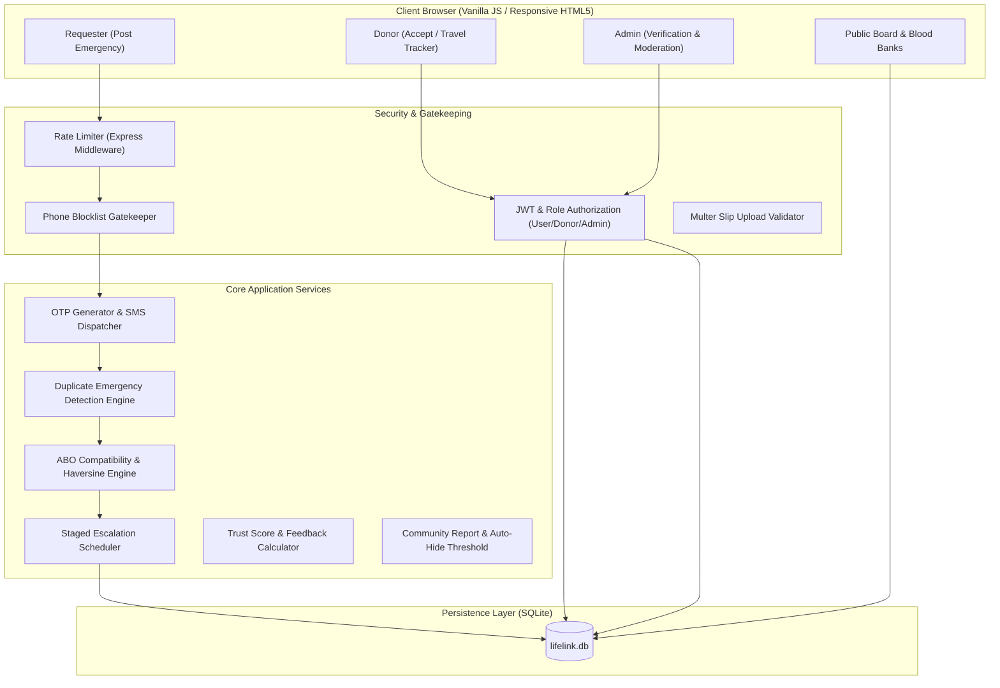
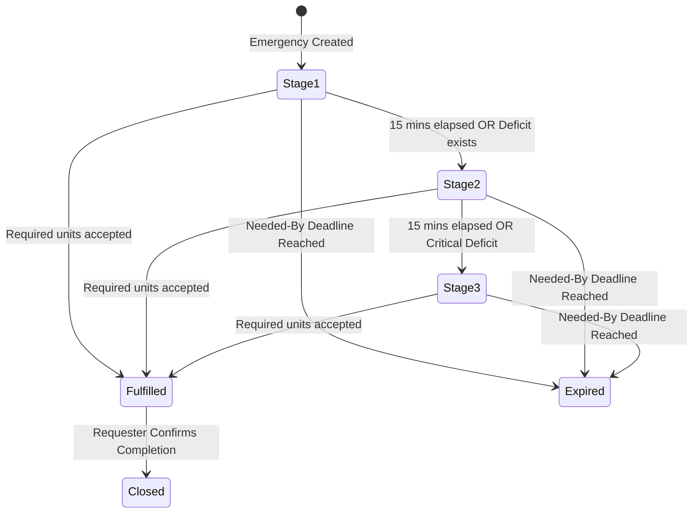
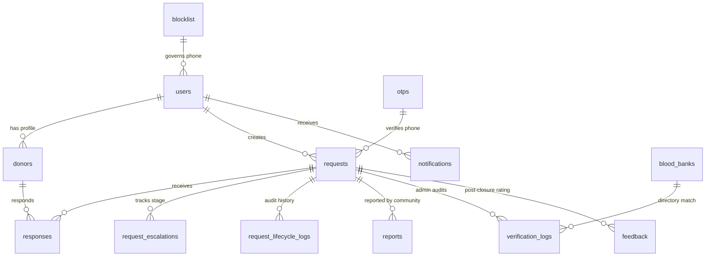

# 🩸 LifeLink — Emergency Blood Donor Finder with Request Verification

[](https://nodejs.org/)
[-blue.svg)](https://www.sqlite.org/)
[](https://jwt.io/)
[](https://expressjs.com/)
[-success.svg)]()

> **LifeLink** is a mission-critical, full-stack emergency blood donor mobilization platform engineered as an advanced college software engineering project. It bridges the critical time gap in medical emergencies—reducing the donor mobilization timeline from hours to minutes—while solving the pervasive real-world problem of fraudulent, duplicate, and unverified blood requests through a 7-layer verification architecture.

---

## 📋 Table of Contents
1. [Problem Statement & Key Innovations](#-problem-statement--key-innovations)
2. [Technology Stack](#-technology-stack)
3. [System Architecture & Data Flow](#-system-architecture--data-flow)
4. [7-Layer Request Verification System](#-7-layer-request-verification-system)
5. [Smart Staged Alert Escalation Engine](#-smart-staged-alert-escalation-engine)
6. [Donor Commitment Lifecycle](#-donor-commitment-lifecycle)
7. [Database Schema (13 Normalized Tables)](#-database-schema-13-normalized-tables)
8. [Complete REST API Reference](#-complete-rest-api-reference)
9. [Pre-Seeded Master Demo Accounts](#-pre-seeded-master-demo-accounts)
10. [Setup & Running Locally](#-setup--running-locally)
11. [Automated Test Suites](#-automated-test-suites)
12. [Project Directory Structure](#-project-directory-structure)

---

## 🎯 Problem Statement & Key Innovations

### The Problem
During clinical emergencies (trauma surgeries, childbirth hemorrhages, acute leukemia transfusions), finding compatible blood is fraught with hurdles:
- **Scattered Contact Lists**: WhatsApp and social media broadcasts often circulate outdated numbers.
- **Unverified & Fraudulent Posts**: Scammers frequently post fake patient details or duplicate existing pleas to harvest phone numbers or solicit unauthorized financial contributions.
- **Donor Notification Fatigue**: Alerting hundreds of donors simultaneously floods donor pools, causing donor apathy when their arrival turns out to be redundant.
- **Donor Accountability Gaps**: Requesters are left guessing whether an accepted donor is actually traveling or will arrive in time.

### The LifeLink Solution
1. **ABO/Rh Blood Compatibility Matching Engine**: Calculates scientific red blood cell compatibility (e.g., $O^-$ universal donor, $AB^+$ universal recipient) combined with Haversine distance proximity sorting.
2. **7-Layer Request Verification**: Incorporates SMS OTP verification, duplicate broadcast detection, hospital directory landline cross-matching, private requisition slip audit queues, and community reporting auto-hide triggers.
3. **Smart Staged Escalation**: Dispatches emergency notifications in controlled waves (Stage 1 $\rightarrow$ Stage 2 $\rightarrow$ Stage 3), automatically pausing when adequate commitments are achieved and re-escalating if an accepted donor withdraws.
4. **Donor Commitment & Travel Progression**: Donors advance through structured states: `Invited` $\rightarrow$ `Accepted` $\rightarrow$ `Availability Confirmed` $\rightarrow$ `On the Way` $\rightarrow$ `Arrived — Self-Reported`.
5. **Strict Two-Sided Privacy Barriers**: Neither donor phone numbers nor requester phone numbers are exposed publicly; direct requester contact is unlocked exclusively to an authenticated donor upon affirmative acceptance.

---

## 🛠 Technology Stack

| Layer | Technologies & Libraries | Rationale |
| :--- | :--- | :--- |
| **Backend** | Node.js (v18+ or v24+), Express.js | High-performance asynchronous non-blocking I/O event loop. |
| **Database** | SQLite via custom transparent adapter (`better-sqlite3` + `node:sqlite`) | Zero-configuration SQL persistence with synchronous query capabilities and full compatibility with modern Node engines. |
| **Frontend** | Vanilla JavaScript (ES6+), CSS3 Variables, HTML5 | Zero-framework footprint, lightning-fast rendering, responsive mobile-first UI with red-and-white healthcare aesthetics. |
| **Authentication** | JSON Web Tokens (`jsonwebtoken`), `bcryptjs` | Stateless session management with salted, 10-round bcrypt password hashing. |
| **File Storage** | `multer` | Secure storage of hospital requisition slips with mime-type enforcement and extension validation. |
| **Notifications** | Pluggable Mock SMS & Email Console Engine | Formatted, zero-cost console logging and in-app bell notification drawer, with clean interfaces for future Twilio, Fast2SMS, or Nodemailer integration. |

---

## 🏛 System Architecture & Data Flow



---

## 🛡 7-Layer Request Verification System

LifeLink enforces seven distinct layers of verification to guarantee emergency authenticity:

1. **Layer 1: Phone OTP Verification**
   - Requesters must verify their phone number via a 6-digit one-time passcode (valid for 5 minutes).
   - Mock OTP is printed clearly in the server terminal for evaluation.
   - Enforces a strict **1 open request per verified phone number** policy.

2. **Layer 2: Duplicate Emergency Detection Engine**
   - Cross-analyzes open requests by patient name, attending hospital, city, and blood group.
   - Exact duplicates are blocked with `HTTP 409 Conflict`.
   - Hospital-level matches with different patients flag a warning modal requiring requester confirmation.

3. **Layer 3: Official Hospital Switchboard Directory Cross-Match**
   - System maintains a verified directory of major hospitals and blood banks with official landline switchboards.
   - Requisition slips are verified by administrators calling the hospital's **official switchboard number**, bypassing whatever phone number the requester wrote on the form.

4. **Layer 4: Private Requisition Slip Audit Queue**
   - Hospital slips and doctor requisition forms are uploaded to a private, non-public directory (`uploads/requisitions/`).
   - Served only to authenticated Administrators via `GET /api/admin/requests/:id/slip`.
   - Public users and donors never have access to raw medical documents.

5. **Layer 5: Community Abuse Reporting with Auto-Hide Threshold**
   - Every emergency post carries a "Report Suspicious Request" button.
   - When a post reaches **3 distinct community reports**, the platform automatically marks it `is_hidden = 1` and halts all outgoing donor alerts pending admin review.

6. **Layer 6: Post-Donation Authenticity Feedback & Requester Trust Score**
   - Following request closure, accepted donors are prompted: *"Was this blood request genuine?"*
   - Algorithm calculates a Requester Trust Score (0 to 100):
     $$\text{Score} = \text{Fulfilled} \times 25 + \text{Hospital Confirmed} \times 20 + \text{Document Verified} \times 10 + \text{Genuine Feedback} \times 15 - \text{Rejected} \times 30$$
   - Users with Score $\ge 50$ earn the public **🌟 Trusted Requester** badge.

7. **Layer 7: Phone Blocklist Gatekeeper**
   - Administrators can immediately block phone numbers identified as sources of fraudulent requests or spam.
   - Blocked numbers are rejected at the OTP gate and cannot initiate requests or donor accounts.

---

## 📡 Smart Staged Alert Escalation Engine

Instead of broadcasting alerts to every donor at once, LifeLink uses a smart multi-stage escalation schedule:



- **Stage 1 (Immediate)**: Alerts the closest 3 to 6 compatible donors within a 10 km radius.
- **Stage 2 (15 minutes)**: If needed units remain uncommitted, expands radius up to 25 km and alerts the next batch.
- **Stage 3 (30 minutes)**: Expands city-wide to all remaining compatible eligible donors.
- **Deficit Auto-Resumption**: If an accepted donor withdraws (`Withdrawn`), the engine automatically triggers an immediate out-of-turn escalation step to backfill the needed units.

---

## 🏃 Donor Commitment Lifecycle

LifeLink replaces simple binary accepts with a real-time commitment tracker:

| Status | Meaning & Availability to Requester |
| :--- | :--- |
| `Invited` | Alert received by donor; decision pending. |
| `Accepted` | Donor accepted; requester's private phone number is unlocked for the donor. |
| `Declined` | Donor unavailable. |
| `Availability Confirmed` | Donor explicitly reconfirmed readiness to travel. |
| `On the Way` | Donor is en route with an optional estimated arrival time (ETA). |
| `Arrived — Self-Reported` | Donor arrived at the hospital transfusion facility. |
| `Withdrawn` | Donor had to cancel; triggers immediate deficit backfill escalation. |

---

## 🗄 Database Schema (13 Normalized Tables)



1. **`users`**: User authentication accounts (`id`, `name`, `email`, `phone`, `password_hash`, `role`, `created_at`).
2. **`donors`**: Medical donor parameters (`id`, `user_id`, `blood_group`, `city`, `pincode`, `latitude`, `longitude`, `last_donation_date`, `is_available`).
3. **`requests`**: Emergency patient requests (`id`, `requester_id`, `patient_name`, `blood_group`, `units_needed`, `hospital_name`, `doctor_name`, `ward_bed`, `city`, `contact_number`, `urgency`, `needed_by`, `short_note`, `requisition_slip_url`, `verification_status`, `status`, `is_hidden`, `is_suspicious`, `suspicious_reason`).
4. **`responses`**: Donor response commitments (`id`, `request_id`, `donor_id`, `status`, `eta_minutes`, `note`, `updated_at`).
5. **`notifications`**: In-app notifications with delivery status (`id`, `user_id`, `request_id`, `title`, `message`, `type`, `channel`, `is_read`, `created_at`).
6. **`request_escalations`**: Multi-stage escalation tracking state (`id`, `request_id`, `current_stage`, `stage1_notified_count`, `stage2_notified_count`, `stage3_notified_count`, `next_escalation_at`, `is_active`).
7. **`request_lifecycle_logs`**: Lifecycle state change audit log (`id`, `request_id`, `old_status`, `new_status`, `changed_by_user_id`, `reason`, `created_at`).
8. **`reports`**: Community fraud and abuse reports (`id`, `request_id`, `reporter_user_id`, `reporter_phone`, `reporter_ip`, `reason`, `details`, `created_at`).
9. **`blood_banks`**: Verified hospital blood bank directory (`id`, `name`, `city`, `pincode`, `address`, `phone`, `operating_hours`, `latitude`, `longitude`).
10. **`verification_logs`**: Audit trail of admin verification actions (`id`, `request_id`, `admin_user_id`, `old_status`, `new_status`, `verification_method`, `notes`, `created_at`).
11. **`blocklist`**: Administrative phone blocklist (`id`, `phone`, `reason`, `blocked_by_user_id`, `created_at`).
12. **`feedback`**: Post-donation authenticity reviews (`id`, `request_id`, `donor_user_id`, `was_genuine`, `comments`, `created_at`).
13. **`otps`**: Phone verification records (`id`, `phone`, `otp_code`, `purpose`, `is_used`, `expires_at`, `created_at`).

---

## 🔌 Complete REST API Reference

### 🔐 Authentication & Accounts
| Method | Endpoint | Access | Description |
| :--- | :--- | :--- | :--- |
| `POST` | `/api/auth/register` | Public | Register donor or requester account with hashed password. |
| `POST` | `/api/auth/login` | Public | Authenticate user credentials and return JWT bearer token. |
| `GET` | `/api/auth/me` | Authenticated | Retrieve profile details of currently logged-in user. |

### 📲 Phone OTP Verification
| Method | Endpoint | Access | Description |
| :--- | :--- | :--- | :--- |
| `POST` | `/api/otp/send` | Public | Generate 6-digit OTP for phone number and print mock SMS to server console. |
| `POST` | `/api/otp/verify` | Public | Verify OTP code before emergency request creation. |

### 🩸 Donors & Medical Profiles
| Method | Endpoint | Access | Description |
| :--- | :--- | :--- | :--- |
| `GET` | `/api/donors/profile` | Donor | Fetch donor details, 90-day medical interval, and current status. |
| `PUT` | `/api/donors/availability` | Donor | Toggle donor availability state (`ON`/`OFF`). |
| `PUT` | `/api/donors/profile` | Donor | Update donor contact, coordinates, or last donation date. |

### 🚨 Emergency Blood Requests
| Method | Endpoint | Access | Description |
| :--- | :--- | :--- | :--- |
| `GET` | `/api/requests` | Public | List open emergency requests on the Public Board (masked phone numbers). |
| `POST` | `/api/requests` | Authenticated | Post emergency request with optional requisition slip upload. |
| `GET` | `/api/requests/:id` | Public / Auth | Get comprehensive request details, progress metrics, and roster. |
| `PUT` | `/api/requests/:id/fulfill`| Requester / Admin | Mark request as fulfilled and halt donor alert escalation. |
| `POST` | `/api/requests/:id/report` | Public / Auth | Submit community abuse report (triggers auto-hide at 3 reports). |
| `GET` | `/api/requests/:id/progress`| Public / Auth | Get live emergency mobilization metrics. |
| `GET` | `/api/requests/:id/trust-score`| Public | Retrieve requester trust score and badge. |

### 🤝 Donor Responses & Commitment
| Method | Endpoint | Access | Description |
| :--- | :--- | :--- | :--- |
| `GET` | `/api/responses/my-alerts` | Donor | View active emergency alerts matched to the authenticated donor. |
| `POST` | `/api/responses/:id/respond`| Donor | Respond to emergency (`Accepted` or `Declined`). |
| `PUT` | `/api/responses/:id/commitment`| Donor | Advance travel status (`Availability Confirmed`, `On the Way`, `Arrived`, `Withdrawn`). |
| `POST` | `/api/responses/:id/feedback` | Donor | Post-closure feedback on request authenticity (`yes`/`no`). |

### 🏥 Blood Banks & Hospitals Directory
| Method | Endpoint | Access | Description |
| :--- | :--- | :--- | :--- |
| `GET` | `/api/blood-banks` | Public | List verified transfusion centers filterable by city and search query. |

### 🛡 Admin Verification & Moderation
| Method | Endpoint | Access | Description |
| :--- | :--- | :--- | :--- |
| `GET` | `/api/admin/stats` | Admin | Overall system metrics (active requests, reports, blocklist count). |
| `GET` | `/api/admin/verification-queue` | Admin | Review pending requests with official hospital switchboard cross-matches. |
| `PUT` | `/api/admin/requests/:id/verify` | Admin | Set verification level (`Hospital Confirmed`, `Document Verified`, `Rejected`). |
| `GET` | `/api/admin/requests/:id/slip` | Admin | Securely stream requisition slip PDF/image file. |
| `GET` | `/api/admin/reports` | Admin | List flagged and auto-hidden community reports. |
| `PUT` | `/api/admin/requests/:id/restore`| Admin | Restore auto-hidden request and dismiss false reports. |
| `GET` | `/api/admin/blocklist` | Admin | List blocked phone numbers. |
| `POST` | `/api/admin/blocklist` | Admin | Block phone number with documented reason. |
| `DELETE`| `/api/admin/blocklist/:id` | Admin | Unblock phone number. |
| `GET` | `/api/admin/verification-logs` | Admin | Audit trail of all verification modifications. |

---

## 👥 Pre-Seeded Master Demo Accounts

Run `node src/db/seedDemoData.js` to seed the database with representative data:

### Administrator Account
| Role | Email | Password | Access Capabilities |
| :--- | :--- | :--- | :--- |
| **System Admin** | `admin@lifelink.org` | `Admin@123` | Full verification queue, requisition slip viewer, moderation, and blocklist control. |

### Representative Donor Accounts (Password: `Donor@123`)
| Name | Email | Blood Group | City | Coordinates | Availability |
| :--- | :--- | :--- | :--- | :--- | :--- |
| **Aarav Patel** | `aarav.patel@lifelink.demo` | **O+** | Mumbai | 18.9894, 72.8354 | Available |
| **Pooja Deshmukh** | `pooja.deshmukh@lifelink.demo` | **A+** | Mumbai | 19.0544, 72.8402 | Available |
| **Rahul Sharma** | `rahul.sharma@lifelink.demo` | **B+** | Mumbai | 19.0178, 72.8478 | Available |
| **Ananya Iyer** | `ananya.iyer@lifelink.demo` | **AB+** | Mumbai | 18.9400, 72.8350 | Available |
| **Vikram Joshi** | `vikram.joshi@lifelink.demo` | **O-** | Mumbai | 18.9550, 72.8190 | Available |
| **Sneha Kulkarni** | `sneha.kulkarni@lifelink.demo` | **A-** | Mumbai | 19.0760, 72.8777 | Available |
| **Rohan Kapoor** | `rohan.kapoor@lifelink.demo` | **B-** | Delhi | 28.5672, 77.2100 | Available |
| **Meera Nambiar** | `meera.nambiar@lifelink.demo` | **AB-** | Bengaluru | 12.9716, 77.5946 | Available |
| *(+ 12 more)* | *(across Delhi, Pune, Chennai, Bengaluru)* | *All Groups* | *Multi-City* | *Accurate Lat/Lon* | *Available* |

### Pre-Seeded Requests Demonstrating All Verification States
| ID | Patient Name | Blood Group | Hospital | City | Verification Status | Lifecycle |
| :--- | :--- | :--- | :--- | :--- | :--- | :--- |
| **#1** | Ramesh Shinde | **B+** | Lilavati Hospital & Research Centre | Mumbai | `Hospital Confirmed` 🟢 | Open (Critical) |
| **#2** | Priya Nair | **O-** | KEM Hospital & Seth GS Medical College | Mumbai | `Document Verified` 🔵 | Open (Critical) |
| **#3** | Amit Verma | **A+** | AIIMS Blood Bank & Transfusion Center | Delhi | `Phone Verified` 🟡 | Open (Urgent) |
| **#4** | Sunita Reddy | **AB+** | Manipal Hospital Transfusion Medicine | Bengaluru | `Hospital Confirmed` 🟢 | Fulfilled ✅ |
| **#5** | Vikramaditya Rao | **O+** | Bombay Hospital & Medical Research Centre | Mumbai | `Unverified` ⚠️ (Suspicious high units: 18 units) | Open |

---

## 🚀 Setup & Running Locally

### Prerequisites
- [Node.js](https://nodejs.org/) version 18.x or 24.x installed.
- Modern Web Browser (Chrome, Firefox, Edge, Safari).

### Installation Steps
```bash
# 1. Clone repository and navigate to folder
git clone https://github.com/your-username/lifelink.git
cd project1

# 2. Install dependencies
npm install

# 3. Initialize & seed SQLite database with demo donors and requests
node src/db/seedDemoData.js

# 4. Start the LifeLink server
node src/server.js
```

The application is now running live at: **`http://localhost:3000`**

---

## 🧪 Automated Test Suites

LifeLink includes a suite of end-to-end integration test runners verifying every core engine:

```bash
# Test Phase 2: Auth, Donor Registration, 90-Day Medical Rule, OTP & Blocklist
node tests/test_phase2_otp.js

# Test Phase 3: Matching Engine, ABO Compatibility, Proximity & Privacy Redaction
node tests/test_phase3_matching.js

# Test Phase 4: Staged Alert Escalation, Donor Commitment Tracker & Auto-Expiry
node tests/test_phase4_lifecycle.js

# Test Phase 5: Duplicate Detection, Hospital Directory Cross-Match, Auto-Hide & Trust Score
node tests/test_phase5_verification.js

# Test Phase 6: Public Emergency Board, Blood Bank Directory & Admin Dashboard UI
node tests/test_phase6_views_and_admin.js
```

*All 5 test suites run independently and exit with code 0.*

---

## 📁 Project Directory Structure

```text
project1/
├── lifelink.db                     # SQLite database file
├── package.json                    # Project metadata & npm dependencies
├── README.md                       # Comprehensive project documentation
├── DEMO_WALKTHROUGH.md             # Step-by-step college presentation script
├── public/                         # Responsive Frontend Assets
│   ├── index.html                  # Landing page with hero "Post Emergency" CTA
│   ├── login.html                  # Login portal
│   ├── register.html               # Donor & user registration
│   ├── post-request.html           # Emergency blood request form with OTP & slip upload
│   ├── request-details.html        # Real-time mobilization tracker & commitment roster
│   ├── donor-dashboard.html        # Donor alert panel & travel commitment controls
│   ├── emergency-board.html        # Public Emergency Board with live search filters
│   ├── blood-banks.html            # Verified Hospital Blood Bank Directory with click-to-call
│   ├── admin-dashboard.html        # Admin stats, verification queue, moderation, blocklist
│   ├── css/
│   │   ├── style.css               # Core styling & healthcare color tokens
│   │   ├── dashboard.css           # Grid layouts for dashboards & verification queue
│   │   └── board.css               # Card layouts & status badges for emergency board
│   └── js/
│       ├── main.js                 # Global auth state, navbar, toast notifications
│       ├── auth.js                 # Register/login client handlers
│       ├── post-request.js         # OTP timer, slip upload preview, duplicate check
│       ├── request-details.js      # Progress bar polling, donor list, fulfillment modal
│       ├── donor-dashboard.js      # Availability toggle, alert cards, travel buttons
│       ├── emergency-board.js      # Live filters, masked phone badges, report modal
│       ├── blood-banks.js          # Hospital directory filtering & click-to-dial
│       └── admin-dashboard.js      # Verification queue actions, landline dialer, slip preview
├── src/
│   ├── server.js                   # Application entry point & Express configuration
│   ├── config/
│   │   └── database.js             # Dual-engine SQLite driver (better-sqlite3 / node:sqlite)
│   ├── controllers/
│   │   ├── authController.js       # Auth & JWT generation
│   │   ├── otpController.js        # OTP generator & verifier
│   │   ├── donorController.js      # Donor profiles & availability
│   │   ├── requestController.js    # Request posting, reporting, progress polling
│   │   ├── responseController.js   # Commitment progression & authenticity feedback
│   │   ├── bloodBankController.js  # Hospital directory queries
│   │   └── adminController.js      # Queue management, verification audits, blocklist
│   ├── middleware/
│   │   ├── auth.js                 # JWT authentication & RBAC guards
│   │   ├── upload.js               # Multer requisition slip upload config
│   │   ├── rateLimiter.js          # In-memory IP rate limiter
│   │   └── validate.js             # Form input sanitization & validation
│   ├── services/
│   │   ├── matchingEngine.js       # ABO/Rh compatibility & Haversine proximity
│   │   ├── escalationService.js    # Staged alert escalation & deficit auto-resumption
│   │   ├── notificationService.js  # Mock SMS & email console formatting
│   │   ├── duplicateDetectionService.js # Duplicate post detection & similarity heuristics
│   │   ├── reportService.js        # Community abuse reporting & 3-report auto-hide
│   │   └── trustScoreService.js    # Requester Trust Score computation
│   └── db/
│       ├── migrate.js              # Database migrations runner
│       └── seedDemoData.js         # Master deterministic demo data seeder
├── tests/                          # Automated Integration Test Runners
│   ├── test_phase2_otp.js
│   ├── test_phase3_matching.js
│   ├── test_phase4_lifecycle.js
│   ├── test_phase5_verification.js
│   └── test_phase6_views_and_admin.js
└── uploads/
    └── requisitions/               # Private hospital slip PDF/JPG storage
```

---

## ⚖️ Disclaimer & Ethics Note
*LifeLink is designed to assist communities during urgent medical situations by facilitating rapid donor communication. It does not replace emergency medical response services (such as dialing 108, 112, or reaching out directly to licensed hospital blood banks). All donations must take place exclusively within certified clinical transfusion centers.*
